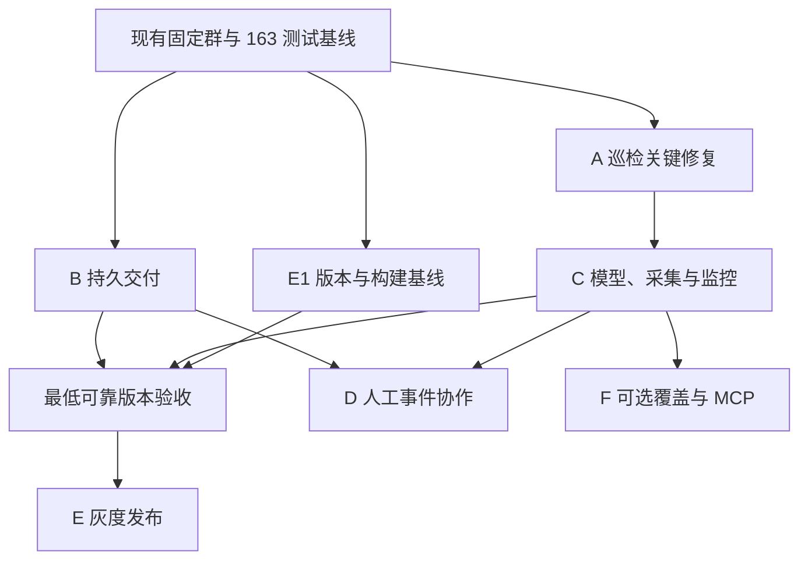

# K8s Inspector 后续整改 Implementation Plan

> **For agentic workers:** REQUIRED SUB-SKILL: Use superpowers:subagent-driven-development (recommended) or superpowers:executing-plans to implement this plan task-by-task. Steps use checkbox (`- [ ]`) syntax for tracking. This document is the coordination plan; execute the linked subsystem plans at their gates.

**Goal:** 将已完成固定群通知的原型整改为结果可信、交付可恢复、事件可追踪、部署可验证的巡检工具。

**Architecture:** 保留 Python/CLI/CronJob 与现有监控链路；先独立修复巡检和通知，再以兼容模型连接采集、规则、报告与监控。事件协作依赖可信证据和持久投递；MCP 保持自包含并以契约测试对齐语义。

**Tech Stack:** Python 3.11、Kubernetes SDK、pytest、stdlib sqlite3、Prometheus/Alertmanager/Pushgateway、lark-oapi、Kustomize；HA 数据库为环境决定后的独立扩展。

**Spec:** [后续整改设计](C:/Users/23033/Desktop/Cluster-Stability-Inspector/docs/superpowers/specs/2026-10-02-remediation-design.md)。

2026-10-14已补齐：6个子计划，共35项任务。文件名沿用2026-10-02初稿日期。此次只修改规划文档；实施第一步仍需建立版本、解释器与测试基线。

2026-10-15进展：E1的基线准备和A1–A6本地整改已实施，独立审查修复后256测试通过；下一批为B可靠投递。完整E1产物验证和E2–E6尚未完成，G2–G4仍待验收。见[实施记录](C:/Users/23033/Desktop/Cluster-Stability-Inspector/审计/10-巡检关键缺陷实施记录-2026-10-15.md)。

## Global Constraints

- 所有子计划继承设计第 4–6 节的版本、兼容、时间、权限、状态与默认值；各任务里的新增接口是目标接口，当前尚不存在。
- 本次只创建规划文档；上轮 163 个测试通过是历史基线，不作为尚未实施任务的验收。
- 原第一批固定群已经完成，不重新实施；其未实现的可靠投递、事件状态和规则治理明确保留。
- 单实例 SQLite 要求经验证的本地持久存储；多副本或共享 NFS 环境改共享事务数据库，不能只增加 replicas。
- 当前无 .git。执行第一任务先建立完整版本基线；各子任务提交步骤在具备仓库条件后执行，不要求本次规划初始化仓库。

## Review Focus

1. worker 发送成功后进程退出，本地尚未标 SENT：B4 验证恢复与重复边界。
2. 当前 FAIL 随采集 ERROR 或指标消失而 resolved：C6/C7 验证 UNKNOWN 与有效恢复。
3. 配置更新改变目的地或 HA 来源标识：B2 验证新的目的地不会被旧去重记录压掉。
4. 资源更换 UID、迟到的旧 resolved 覆盖新 firing：C1/D2 验证 episode 和版本。
5. 本地测试正常但 wheel/镜像/真实 PVC 不可用：E1/E2/E4 验证产物和真实存储。

## 1. 工作拆分与顺序

| 批次 | 子计划 | 核心交付 | 前置 | 单人有效工作日估算 |
|---|---|---|---|---:|
| A | [巡检关键缺陷修复](C:/Users/23033/Desktop/Cluster-Stability-Inspector/docs/superpowers/plans/2026-10-02-critical-inspection-fixes.md) | Pod/PVC/证据/latest/sink 正确性 | 当前基线 | 4–6 |
| B | [可靠告警交付](C:/Users/23033/Desktop/Cluster-Stability-Inspector/docs/superpowers/plans/2026-10-02-reliable-alert-delivery.md) | 持久接收、每目的地投递、去重、重试、入口鉴权与自监控 | 基线；生产前确认存储 | 5–8 |
| C | [巡检模型与监控治理](C:/Users/23033/Desktop/Cluster-Stability-Inspector/docs/superpowers/plans/2026-10-02-inspection-foundations-and-monitoring.md) | 执行质量、结构化证据、受控采集、有效观察、规则单源 | A；接入 B 的可观测约定 | 6–9 |
| D | [人工事件协作](C:/Users/23033/Desktop/Cluster-Stability-Inspector/docs/superpowers/plans/2026-10-02-manual-incident-workflow.md) | 人工升级、负责人、群绑定、成员状态、验证恢复与结案 | B、C 核心完成 | 4–6 |
| E | [生产部署与发布](C:/Users/23033/Desktop/Cluster-Stability-Inspector/docs/superpowers/plans/2026-10-02-production-release.md) | 包/镜像、生产 overlays、备份、灰度与交接 | E1 可提前；E2 与 B 配合；完整验收在 A/B/C 后 | 3–5 + 7–14 天观察 |
| F | [覆盖扩展与 MCP 加固](C:/Users/23033/Desktop/Cluster-Stability-Inspector/docs/superpowers/plans/2026-10-02-coverage-and-mcp.md) | 工作负载/压力/能力、MCP 依赖与安全、资源计算 | C；可选能力单独发布 | 4–7 |

新的细化估算比原概略路线图保守：最低可靠版本 A+B+C+E 为 18–28 个有效工作日；完整加入 D/F 为 26–41 日，再加观察与环境等待。第一批已完成工作不计入该估算。若多副本、SSO/飞书回调、外部对象存储或无可用本地状态卷，需要重新估算相应扩展，不能沿用此总数承诺日期。

A 与 B 的代码大部分独立，可以由不同实施者同时推进；C 必须统一模型契约，D 依赖 B/C。当前任务只做规划，不启动子代理或新的聊天任务。

## 2. 推荐实际执行排期

| 顺序 | 任务 | 交付检查点 |
|---|---|---|
| 第一组 | E1 的基线/依赖准备，A1–A3，B1–B2 | 修正漏报/正常 PVC 误报；重复请求只能形成一组目的地任务 |
| 第二组 | A4–A6，B3–B5 | 已确认故障不被覆盖；latest 能跟随恢复；重试不阻断其他目的地；异步 ACK 契约成立 |
| 第三组 | B6–B7，C1–C3，E2 | 状态从 Pod 替换恢复；磁盘/队列故障可见；采集期限和分页明确 |
| 第四组 | C4–C7，E3–E5 | 未知、从未运行、指标丢失、有效恢复与主要告警来源通过验证 |
| 第五组 | D1–D6 | 重大事故能够人工升级并正确结案，建群结果未知不会盲目重建 |
| 第六组 | F1–F3、E6 | 按需要扩大覆盖，完成可选 MCP 与最终运营交接 |

若当前每天都在使用巡检结果，优先 A1–A4；若通知已在生产使用，B 的入口和持久交付同步优先。两条风险都真实存在，不能仅因上一批改了 Bridge 就无限推迟巡检漏报修复。

## 3. 各批次文件责任

| 范围 | 当前文件 | 拟新增责任 |
|---|---|---|
| 巡检与配置 | [checks.py](C:/Users/23033/Desktop/Cluster-Stability-Inspector/k8s_inspector/checks.py)、[common.py](C:/Users/23033/Desktop/Cluster-Stability-Inspector/k8s_inspector/common.py)、[config.py](C:/Users/23033/Desktop/Cluster-Stability-Inspector/k8s_inspector/config.py) | 先修原函数，后逐领域拆纯规则；不一次改全部接口 |
| 运行与输出 | [cli.py](C:/Users/23033/Desktop/Cluster-Stability-Inspector/k8s_inspector/cli.py)、[report.py](C:/Users/23033/Desktop/Cluster-Stability-Inspector/k8s_inspector/report.py) | runner、sink 独立结果、原子发布、带 run_id 的报告 |
| 通知 | [alertmanager_bridge.py](C:/Users/23033/Desktop/Cluster-Stability-Inspector/k8s_inspector/alertmanager_bridge.py)、[alert_routing.py](C:/Users/23033/Desktop/Cluster-Stability-Inspector/k8s_inspector/alert_routing.py)、[feishu_app.py](C:/Users/23033/Desktop/Cluster-Stability-Inspector/k8s_inspector/feishu_app.py) | bridge_store、delivery_worker、delivery_adapter、bridge_observability；旧 JSON 映射仅保留迁移来源 |
| 事件 | SDK 群管理方法存在但未接入 | incidents、incident_policy、incident_cli、recovery_evidence |
| 监控与发布 | [metrics.py](C:/Users/23033/Desktop/Cluster-Stability-Inspector/k8s_inspector/metrics.py)、deploy/、[pyproject.toml](C:/Users/23033/Desktop/Cluster-Stability-Inspector/pyproject.toml) | expected targets、单源 rules、可选组件和生产 overlays、CI |
| MCP | [mcp_server.py](C:/Users/23033/Desktop/Cluster-Stability-Inspector/k8s_inspector/mcp_server.py) | 保持自包含，补独立 extra、安全与资源计算契约测试 |

## 4. 发布门槛

### G1：离线正确性

- [ ] 现有测试持续通过；新增测试针对实际误报/漏报/故障链路，不以测试数量代替质量。
- [ ] Ready=False、init CrashLoop、历史 OOM、Lost/等待消费者 PVC、metrics 故障后已有 FAIL 均有明确结果。
- [ ] FAIL→有效 PASS 刷新 latest；报告写失败仍尝试指标；strict/always0 行为有断言。

### G2：通知可靠性

- [ ] 事务提交后才 202；提交失败/容量不足不 ACK；重启恢复 pending。
- [ ] 重复请求、多目的地部分失败、lease 到期、发送成功本地失败的行为可复查。
- [ ] 发送永久错误、dead、积压、库不可写和来源失明均有监控；凭据不进日志或指标标签。
- [ ] SQLite 本地卷与单实例成立；不能只凭 YAML 解析宣布持久化可靠。

### G3：最低可靠版本

- [ ] 包安装、镜像入口、Kustomize 渲染、规则测试、最小 RBAC、真实测试 PVC 成立。
- [ ] 从未运行、Pushgateway 清空、FAIL→ERROR、FAIL→有效健康和新旧规则退役通过演练。
- [ ] shadow 与灰度记录误报/漏报原因、API 请求量、耗时与交付积压；完成一次真实测试故障与恢复闭环。

### G4：事件协作

- [ ] 人工升级可绑定已有群，创建有独立授权/限额/操作状态；重复升级不重复建群。
- [ ] 部分恢复与未知不结案；旧 resolved 不覆盖新 episode；外部创建结果不明要求核对。
- [ ] 负责人、处理结论、操作审计、备份和状态迁移可复查。

## 5. 评审问题覆盖映射

| 历史问题 | 任务归属 | 当前说明 |
|---|---|---|
| F01/F02 | A2、C4、F3 | 当前/历史 Pod 状态分开，MCP 使用同 fixtures |
| F03/F07 | A4、C2/C4、F1 | 保留已知 FAIL，压力/覆盖分开 |
| F04 | A3、C4 | PVC 语义与资源关系 |
| F05/F06/F08 | A4、C4、F1 | 能力边界、Addon Ready、Event 时间窗口 |
| F09/F10 | C2/C3、E3 | timeout、分页、复用、CronJob 总期限 |
| F11/F33 | A1、C1/C3 | 配置与模型分离 |
| F12/F13/F14 | A5/A6、C5 | sink、latest、原子输出、报告详情 |
| F15/F16/F17 | C6/C7、D4 | inventory、未知与有效恢复、主来源 |
| F18 | 已完成业务响应校验；B3/B4 继续 | 错误分类、超时、重试和幂等仍未完成 |
| F19/F20/F21 | B1/B2/B4/B7、D3 | 当前固定群已绕开旧群映射；新持久状态与外部操作仍需实现 |
| F22/F23 | 已完成部分边界/退出；B5/B6/E2 继续 | 鉴权、线程上限、背压、在途交付仍需补强 |
| F24/F25/F26/F27 | F2/F3 | MCP 可选，但启用前必须过安全与准确性门槛 |
| F28/F31 | E1/E4/E5 | 产物、依赖、CI、真实链路 |
| F29/F30 | B7、E2/E3 | 存储分离、环境 overlay、期限与权限 |
| F32/F35 | C3/C7、E6 | 单源生成、能力文档与操作手册 |
| F34 | A5、E3/E6 | 清理真实统计、路径与时区、dry-run |
| F36 | A1/C2 相邻修改时处理 | 低优先级边界，不单独延迟主交付 |

## 6. 执行和变更控制

每个子任务遵循：写失败用例 → 单项确认 FAIL → 最小实现 → 单项 PASS/必要回归 → review → 独立提交或明确快照。一次只改变一种主要契约；跨模块接口以设计中的名称为准。

建议选择Native方式，由当前会话按任务串行实施，关键接口变更在阶段边界审查，最终做一次独立审查；若用户选择子代理方式，再按 Superpowers 的 subagent-driven-development 每项启动实施与审查代理。本次规划不自动代替用户选择执行方式，也不创建任务或自动化。

自审已核对：36 组历史问题有归属；已完成项没有重新算入工期；接口/状态/默认值在子计划中一致；外部幂等和状态持久化没有虚假的无损/恰好一次承诺；可选能力不阻塞最低可靠版本。
