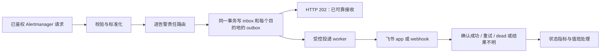

# K8s Inspector 后续整改设计

日期：2026-10-02（Asia/Shanghai）。状态：供本次详细规划使用的设计基准；后续执行前核对真实部署条件。本次只写规划，不修改业务代码或执行部署。

补齐与复核日期：2026-10-14；保留初稿文件名，避免中断后重建一套重复计划。当前没有.git，终端PATH未发现python；163测试通过属于上一批历史记录。MCP当前导入.common，与AGENTS的自包含约定不一致，F2明确安排修正和独立安装验证。

## 1. 已确认的目标与当前基线

用户希望将手工原型改造成可持续使用的集群巡检工具，并已确认固定责任群通知、重大故障按事件协作的方向。当前第一批已实现固定群、标签路由、兜底、输入校验和基础交付验证，上轮 Python 3.11/3.14 都通过 163 个测试。这是已有验证记录，本次没有重新运行产品测试。

依据：[全项目评审](C:/Users/23033/Desktop/Cluster-Stability-Inspector/审计/04-全项目技术评审-2026-10-02.md)、[原路线图](C:/Users/23033/Desktop/Cluster-Stability-Inspector/审计/05-整改路线图-2026-10-02.md)、[建群策略](C:/Users/23033/Desktop/Cluster-Stability-Inspector/审计/07-告警路由与建群策略-2026-10-02.md)、[第一批实施记录](C:/Users/23033/Desktop/Cluster-Stability-Inspector/审计/08-第一批整改实施记录-2026-10-02.md)。源码以本次读取的当前文件为准，原评审行号是历史定位。

成功标准：明确发现当前故障，保留证据；采集未知可见；每次有效运行刷新 latest；通知可以重试并从重启恢复；告警聚合与事件身份分开；重大事件有负责人、成员状态和结案依据；部署可验证、可恢复。

## 2. 规划假设与待核实环境

先按一个集群、已有 Prometheus/Alertmanager、Bridge 单实例、状态库本地持久卷、Python 3.11 为发布运行时规划。用户尚未提供真实 K8s 版本、节点/Pod 数量、CSI/StorageClass、监控安装方式、责任团队和机器人权限。

这些答案不阻塞离线缺陷修复与设计，但会阻塞相应生产验收。多副本或只有共享 NFS 时，状态存储改为共享事务数据库；SQLite 方案不作为 HA 承诺。节点本地卷不能自动承诺节点故障后的无损切换，备份恢复目标要单独验证。

| 前置条件 | 在何时落实 | 不满足时的动作 |
|---|---|---|
| 正式版本基线、当前配置备份 | 首个实施任务前 | 先做完整快照；建立 Git 前核实当前目录不是误复制的子目录 |
| 状态卷的真实存储语义 | B7、E2 前 | 暂停异步持久投递上线，继续现有同步固定群；或改共享数据库 |
| 目标 K8s 版本与集群规模 | A2/A3 规则验收、C2/C6 前 | 使用版本标注的 fixtures，不宣称所有版本适配 |
| 固定群、成员归属、机器人权限 | 首次真实发送前 | 离线 fake 验证，缺少路由仍使用已配置兜底群 |
| Alertmanager/Prometheus 实际版本 | B5/C7/E3 前 | 按部署版本选择兼容配置，不能直接套用 latest 文档新增字段 |
| 真实集群与专用测试群的使用范围 | E5 前 | 所有实际发送与故障演练在约定范围内进行 |

## 3. 技术路线取舍

推荐渐进整改：保留 Python、CLI、CronJob、Kubernetes SDK、Pushgateway 和固定群；独立补齐模型、受控采集、持久投递和人工事件管理。第一版不增加 Redis/Celery、不把所有组件改成 Web 平台，也不增加自动修复或自动驱逐。

另一方案是直接建设长驻采集服务和多副本数据库，适合已有严格 HA 需求，但会同时改变运行与运维模型。全仓重写会扩大数据契约和部署迁移风险，目前没有支撑它的性能证据。

MCP 按最新 AGENTS.md 保持自包含部署；先用契约 fixtures 保证与巡检语义一致，不强制导入共享模块破坏独立部署能力。

## 4. 全局约束

- 发布运行时：Python 3.11；Python 3.14 作为额外回归。当前声明 `>=3.9` 保留，直到明确决定并更新兼容声明；不能把语法检查当作 3.9 运行时验证。
- 保留公开 CLI `run`、`cleanup` 和现有 profiles；旧 Report 的 generated_at/cluster/summary/results 保留兼容。
- 保留 PASS/WARN/FAIL/SKIP 显示接口，新增执行质量与观察健康字段；异常隔离继续有效，已确认 FAIL 不被后续错误替换。
- 正常执行时保留退出码 0/2，以及 `--fail-on warn` 的 1；程序/必需 sink 错误在 strict 模式返回 1。`always0` 仍覆盖进程退出码，但不能覆盖 run_success、sink 状态和错误日志。配置/解析错误仍在启动阶段报错。
- 5m 不采集 Metrics API；其他 profile 的范围保持既有约定，新增能力需显式加入 profile。
- 日常通知固定群；事件建群默认关闭；仅人工授权的事件升级才允许创建或绑定协作群；critical 标签不能直接触发建群。
- 通知接口采用至少一次处理语义；不承诺端到端恰好一次。外部操作结果不明必须单独记录。
- Bridge 数据库与报告存储分离；状态不放 emptyDir，也不以共享 NFS SQLite 代替事务数据库。
- 新配置优先级：显式 CLI → env → 文件 → 默认；未知字段、非有限数值、负期限和无效身份启动报错；输出有效配置时脱敏。
- 只读集群权限；不默认增加 pods/exec、cluster-admin、自动删除/驱逐或任意网络扫描。
- 时间在模型和状态库使用带时区 UTC；用户界面按 Asia/Shanghai 显示。存量无时区数据需显式兼容或拒绝，不推测为健康证据。
- 新模块先放在当前包内的小型文件中；新增子包时同步 setuptools 打包发现，避免本地测试通过但 wheel 漏文件。

## 5. 阶段目标与建议默认值

以下数值是首版实现与离线测试基准，不是已达成的 SLO；发布前根据真实规模调整。

| 配置 | 初始值 | 语义 |
|---|---:|---|
| pod_unready_grace_seconds | 120 | 已运行 Pod 持续不 Ready 的宽限期 |
| pod_pending_grace_seconds | 300 | Pending 的宽限期，结合调度原因 |
| pvc_pending_grace_seconds | 300 | 普通 Pending 的观察期；WaitForFirstConsumer 无消费者不直接 FAIL |
| API connect/read timeout | 3s / 10s | 重试与分页共享整次运行剩余期限 |
| API 临时失败重试 | 最多 2 次重试 | 403、无效配置不重试；重试不超出 deadline |
| profile 运行 deadline | 5m=240s；10m=480s；hourly=900s；daily/full=1800s | CronJob activeDeadlineSeconds 留停机余量，不能只靠线程 timeout 宣称已取消底层请求 |
| Bridge body limit | 1 MiB | 沿用第一批；可配置且有限 |
| Bridge 同时处理请求 / backlog jobs | 16 / 10000 | 到达上限时 503，不先 ACK 再丢任务 |
| 通知内容去重窗口 | 300s | 窗口内重试复用，窗口外相同活动状态允许再次提醒 |
| 投递 lease / provider timeout | 60s / 10s | 单 worker 首版；lease 使用 token 防止旧 worker 提交新 lease 的结果 |
| 投递尝试 | 首次 + 最多 5 次重试 | 基准延迟 5、15、45、120、300 秒加抖动；Retry-After 若存在则尊重且受总上限约束 |
| 已发送 inbox/outbox 保留 | 30 天 | 未发送、未知和待处理 dead 不能静默 GC |
| 人工事件恢复观察 / 复开窗口 | 10 分钟 / 30 分钟 | 必须有同范围新鲜有效健康证据；独立于 Alertmanager repeat_interval |
| 人工建群预算 | 每小时 2 个；活跃事件群 5 个 | 可配置，触顶仍可绑定已有群或在固定群处理；自动建群为关闭 |

## 6. 数据和身份契约

新增类型在 C1 或 B1/D1 中定义，任务不得自造不兼容别名。

| 类型 | 定义与用途 |
|---|---|
| ExecutionStatus | OK / PARTIAL / ERROR / UNSUPPORTED / SKIPPED |
| ObservationHealth | HEALTHY / UNHEALTHY / UNKNOWN |
| Severity | INFO / WARN / FAIL；与事故等级独立 |
| ResourceRef | kind、namespace、name、uid、container、owner_uid、node，可选关系缺失保持 None |
| Coverage | expected: int\|None、observed: int、complete: bool；unknown 分母不伪装 0% 或 100% |
| Finding | rule_id、severity、resource、reason、summary、evidence、observed_at、fingerprint；当前与历史规则分开 |
| CheckExecution | rule_id、execution_status、observed_at、duration_ms、coverage、error_kind、reason |
| RuleObservation | rule_id、cluster_id、scope、resource_uid、health、observed_at、complete、run_id；恢复需要覆盖范围可证明 |
| CheckEvaluation | execution: CheckExecution、findings: tuple[Finding,...]、observations: tuple[RuleObservation,...] |
| Report v2 | 在旧 Report 上加 schema_version=2、run_id、profile、executions、findings、observations、sink_results；旧构造仍可输出 v1 |
| DeliveryJob | delivery_id、source_id、destination_id、content_hash、generation、payload、state、attempt_count、next_attempt_at、lease_token、lease_until、external_id、error_kind |
| DeliveryResult | success、retryable、result_unknown、external_id、error_code；所有字段由适配器契约明确产生 |
| Incident | incident_id、episode、title、owner_team、owner、impact、state、chat_id、created_at、version |
| IncidentMember | source_id、alert fingerprint、startsAt 发生周期、可选 resource_uid/rule_id、最新可信状态与时间 |
| Actor | principal_id、roles；来自凭据或已验证身份，不信任 payload 自报 actor |

告警实例用 source_id + fingerprint + startsAt 区分发生周期；fingerprint 缺少时用规范标签生成备用指纹并标记质量不足。HA 副本使用统一逻辑 source_id。groupKey 只表示通知聚合，不决定 incident_id/chat_id。

实施契约补充：DeliveryResult可带retry_after_seconds；IncidentMember包含member_id、incident_id、latest_status、latest_received_at和identity_quality。成员身份字段和状态版本不可由不同任务重新命名；团队授权由可信principal配置提供。

通知内容 hash：排序后的告警状态、完整标签、影响展示的 annotations、fingerprint、startsAt；resolved 含 endsAt，firing 的滚动 endsAt 不参与去重。相同告警的 severity/summary 变化产生新内容；排序变化不产生新内容。目的地与 source_id 参与任务身份。窗口内同内容重试或活动 pending job 复用；已发送内容超过窗口可创建新 generation，不能永久压掉 repeat 提醒。

## 7. 可靠通知流程

当前同步模式仍以实际交付成功返回 200。切换 async 时 202 只表示本地持久提交完成，绝不表示飞书送达。数据库不可写、队列容量不足时 503；格式 400；鉴权失败 401/403；body 413。同一请求所有目的地须在一个事务内入队，禁止部分入队却完整 ACK。

消息发送可以有界重试；webhook 超时重试可能重复，卡片/文本携带稳定 delivery_id 便于识别。app 使用验证过的 SDK uuid 参数，但必须核实供应商幂等窗口和错误行为。建群结果未知不得套用消息重试规则再次 create。

投递状态 PENDING → SENDING → SENT / RETRY_WAIT / DEAD；结果不明作为独立结果标志留存。lease 到期可恢复消息投递，但旧 lease token 不能覆写新任务结果。永久错误进入待处理状态，不能无限重试或泄漏凭据。

Bridge 至少提供 /healthz 存活、/readyz 接收能力、/metrics 投递质量；就绪需要状态库可写且 worker 活跃。dead、积压年龄、worker 停止和磁盘不足通过独立监控通知，不能只依赖正在故障的同一发送链。

## 8. 巡检与监控契约

运行未完全成功与业务发现 FAIL 分开。一次检查已发现 Node NotReady，之后 metrics 异常，仍保留 FAIL 并记录 PARTIAL；没有有效数据时 health=UNKNOWN，不把发现计数缺省 0 解释为健康。

Pod 检查读取 Ready、普通/init 容器当前状态、删除/Job 生命周期；历史 last_state OOM 只进入历史稳定性证据。PVC Lost 明确失败；Pending 结合 age、消费者和 StorageClass；等待首个消费者的正常延迟不直接告警。Node pressure、控制面能力与 Event 窗口有独立规则，不以 Running 宣称功能健康。

latest JSON 每次运行更新并原子发布；issue 决定额外归档，不能决定是否更新当前状态。归档有独立 run_id；报告写失败仍尝试指标和其他 sink。详细对象留报告/事件存储，Prometheus 只保留受控标签。

expected cluster/profile inventory 由配置/部署生成并由监控独立读取。告警覆盖从未出现指标、停止运行、push 丢失、数据过期和采集质量不足；业务恢复要求最新有效 observation，未知期间事件待验证。每条 rule 指定主要告警 profile，其他 profile 的同类观察保留在报告，不重复主通知；主要来源失明单独报警，不凭空宣称备份来源已接管。

## 9. 人工事件流程

固定群始终是日常入口。授权操作者通过本地 CLI 调用受保护的管理接口，创建事件、关联成员、指定负责人、创建或绑定已有协作群。第一版不接飞书按钮回调，不做自然语言自动根因合并。

状态 OPEN → ACKNOWLEDGED → INVESTIGATING → RESOLVED → CLOSED；复发在窗口内 REOPENED；误关联/不适用可 CANCELLED，必需原因，不能标成健康恢复。成员部分恢复、截断、inhibition、silence 或 source 失明不自动恢复整个事件。

创建群前持久登记创建操作；已确认 chat_id 才绑定。外部创建成功、本地登记失败或超时结果不明，记录 RECONCILE_REQUIRED，交由授权操作者核对/绑定，禁止盲目重新创建。已解决群保留复盘信息；第一版不自动解散。

## 10. 验收与交付边界

最低可靠版本包含 A、B、C 的核心质量/监控任务以及 E 的生产基础验证。D 人工事件协作在其后；F 覆盖扩展/MCP 独立可选，不拖延可靠巡检版本。自动关联与自动建群仅在独立试运行和另一个设计周期后考虑。

本次输出设计与多份子计划，不安装产品依赖、初始化仓库、创建分支、执行外部通知或部署。没有 .git 时先明确版本基线，不能用不存在的提交/PR 作为验收凭证。

## 11. 参考依据

SQLite 的网络文件系统锁风险及多服务端取舍：[官方适用场景](https://www.sqlite.org/whentouse.html)。Pod Ready 与容器状态：[Pod 生命周期](https://kubernetes.io/docs/concepts/workloads/pods/pod-lifecycle/)。PVC 等待消费者：[StorageClass binding mode](https://kubernetes.io/docs/concepts/storage/storage-classes/#volume-binding-mode)。Webhook 分组与字段：[Alertmanager 配置](https://prometheus.io/docs/alerting/latest/configuration/#webhook_config)。选定 SDK 提供 message uuid builder：[官方 Python SDK 源码](https://github.com/larksuite/oapi-sdk-python/blob/v1.7.3/lark_oapi/api/im/v1/model/create_message_request_body.py)；字段存在不代表所有重试场景恰好一次。
