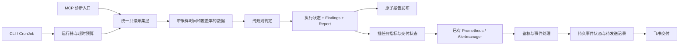

# K8s Inspector 全项目技术评审

评审日期：2026-10-02。对象：当前目录中的 0.1.0 代码快照。

**后续实施说明**：本文保留整改前的发现与源码行号。用户确认后，固定群通知第一批已实施，见 [实施记录](C:/Users/23033/Desktop/Cluster-Stability-Inspector/审计/08-第一批整改实施记录-2026-10-02.md)；涉及文件的原版本见该记录中的源码快照。下文“业务代码和部署未修改”描述的是评审当时状态，不能据此判断当前整改进展。

**结论：项目已经具备可运行原型的结构，但尚不具备可靠的生产巡检与故障闭环能力。应保留 Python、Kubernetes SDK、CLI、CronJob 和多格式输出，重点重构判定模型、采集边界与告警状态管理。整仓推倒重写没有必要。**

本次阅读了全部 14 个生产 Python 文件，共 3,502 行，全部 7 个测试模块及其包初始化文件、16 个部署文件、构建配置、README、AGENTS.md，并对照了已有审计材料。现有 95 个测试全部通过；另完成 20 个离线定向观察，结果见 [验证记录](C:/Users/23033/Desktop/Cluster-Stability-Inspector/审计/06-验证记录-2026-10-02.md) 和 [复现结果](C:/Users/23033/Desktop/Cluster-Stability-Inspector/审计/复现结果.json)。业务代码和部署清单未修改。

当前目录没有 `.git`，不能检查历史提交、真实变更范围或历史密钥泄漏。没有连接真实集群，没有发送飞书消息，没有构建或部署镜像。文中区分代码可确认缺陷、带触发条件的风险、尚未实现的能力；没有把这些检查描述为生产验证。测试环境是 Windows/Python 3.14.5，不能替代 Docker 中 Python 3.11 的兼容性验证。

**优先级含义**：P1 是生产使用前应处理的正确性、安全或可靠性问题；P2 是下一阶段应处理的设计和运维不足；P3 是低影响修整。没有足够证据认定无条件可利用的 P0。下文共 36 组问题：P1 23 组、P2 12 组、P3 1 组，组内可能包含多个相关缺陷；可选组件的优先级以是否启用为前提。

## 值得保留的基础，以及真正需要重构的部分

| 部分 | 处理方式 | 原因 |
|---|---|---|
| Python + Kubernetes SDK | 保留 | 没有证据表明换语言会解决目前的误报、漏报和状态丢失 |
| CLI + CronJob | 保留并加固 | 适合定时巡检；需要超时、运行状态、调度与交付保障 |
| `CheckResult` / `Report` 思路 | 保留边界，重设计字段与语义 | 现在把执行失败、业务风险、未覆盖和跳过混在一起 |
| `checks.py` | 按领域逐步拆分，重写重点判定 | 采集与判断混合，早返回丢证据，缺少对象级结构化发现 |
| `kube.py` | 扩展为统一采集层 | 超时、分页、权限分类、数据覆盖率和客户端生命周期没有统一治理 |
| Bridge + JSON 状态文件 | 优先重构 | 当前存在并发丢更新、状态易失、恢复通知重试失效 |
| Pushgateway + Prometheus | 有条件保留，重设计规则与运行指标 | 短任务适用，但当前只记录报告时间，无法证明检查有效或告警可交付 |
| JSON/CSV/HTML 输出 | 局部改造 | 基础实现可以复用，需要原子发布、详情与版本标识 |
| MCP | 作为可选入口收敛并加固 | 不宜让诊断入口成为另一套不一致的判定和配置体系 |
| `deploy/` | 重组为 base + 环境 overlays + 演示监控栈 | 硬编码 NFS、服务名、默认应用机器人，部署依赖过重 |

## 巡检正确性与检查覆盖

### F01 · P1 · Pod 检查漏掉实际不能提供服务的状态

证据：[common.py:113](C:/Users/23033/Desktop/Cluster-Stability-Inspector/k8s_inspector/common.py:113)、[checks.py:200](C:/Users/23033/Desktop/Cluster-Stability-Inspector/k8s_inspector/checks.py:200)。判定仅关注 `Failed/Unknown`、少数 waiting reason、上一次 terminated reason 和累计 restart_count。

没有检查 Pod Ready/ContainersReady、`container_statuses[].ready`、PodScheduled、Pending 持续时间、init_container_statuses、当前 terminated.exit_code、长期 terminating。Pending 且没有普通容器状态、Running 但 readiness 失败、init 容器 CrashLoopBackOff 都可能得到 PASS，已由 R01–R03 复现。

**影响**：Deployment 的所有副本可以处于 Running 但不能进入服务端点，报告仍称“Pods healthy”。初始化故障则可能长期没有 FAIL。

**整改**：以 Pod 条件、容器类型、当前状态、持续时间和所属工作负载共同判定；输出容器名、原因、时间、UID、owner、影响对象。Pending/启动中的短暂状态采用宽限期；不能简单把所有 Pending 一律标 FAIL。

### F02 · P1 · 把历史问题当成当前故障，缺少时间与生命周期语义

证据：`common.py:127–133`、`checks.py:226–247`、`checks.py:352–361`。

`last_state.terminated.reason == OOMKilled` 会直接判异常，即使容器已经重新运行且 Ready。R04 中当前健康容器因历史 OOM 得到 FAIL。`restart_count >= 3` 使用生命周期累计值，既没有一天的窗口，也没有相邻采样增量；长期运行的 Pod 很容易始终 WARN，控制面组件甚至始终 FAIL。

Failed 的旧 Job Pod、已经结束的批任务也没有根据 owner、Job 当前状态、失败时间和保留策略处理，会持续占用故障计数。另一方面，当前容器异常与历史异常也没有分开呈现。

**整改**：当前可用性和近期稳定性分成不同 rule_id；重启增长优先读取 Prometheus 时间窗口，否则按 Pod UID + 容器身份保存采样基线。累计值下降、Pod 更换和长时间断采需要明确处理。历史 OOM 保留为有时间范围的证据，不能无期限代表当前不可用。

### F03 · P1 · 早返回与大范围异常捕获会丢掉已确认故障

证据：`checks.py:73–159`、`checks.py:234–248`、`checks.py:324–413`。

三个具体问题：

1. 同时存在异常 Pod 和另一个高重启 Pod，返回数据只含 `bad`，丢掉 `restart_heavy`。R05 已复现；下游指标随后把未携带的重启发现算成 0。
2. 已找到 NotReady 节点，后续某条 metrics 数量无法解析，整个检查被捕获成 WARN，NotReady 的 FAIL 丢失。R08 已复现。
3. `/healthz` 已失败，但随后 list 控制面 Pod 抛出异常，最终只得到“Control plane inspection error”的 WARN，而不是保留健康探测失败。R09 已复现。

Node 同时 NotReady 和高资源使用时，FAIL 分支也没有携带 `over_cpu/over_memory`，虽然 utilization 仍在。

**整改**：采集结果按数据源独立记录；规则累计发现后统一汇总最高业务严重度；后续采集失败不能降低既有故障等级。框架边界兜底有价值，但需要保留既有证据与执行错误，不能用一个大 `except` 替换全部结果。

### F04 · P1 · PVC 判定存在确定漏报和正常状态误报

证据：`checks.py:162–188`。只检查 Pending，其他状态均输出“PVCs bound”。R10 中 `phase=Lost` 得到 PASS 且摘要是“PVCs bound: 1”。

Pending 没有持续时间门槛、是否被工作负载使用、StorageClass 绑定策略和事件上下文。新建 PVC、未使用 PVC，以及 `WaitForFirstConsumer` 等待消费者的合法过程，都可能被立即当成故障。Kubernetes 明确支持延迟绑定，见 [Storage Classes](https://kubernetes.io/docs/concepts/storage/storage-classes/#volume-binding-mode)。

**整改**：明确处理 Bound、Lost、Pending、删除中和未知状态；对 Pending 引入 age + 消费者 + StorageClass + 事件规则。增加存储检查应优先使用只读状态与指标，不要为了巡检一开始就给予 `pods/exec` 权限。

### F05 · P1 · 控制面“健康”的结论超出实际证据

证据：`checks.py:311–414`、`kube.py:62–100`。

目前只有一个 `/healthz` 请求，以及三个固定标签下 Pod 的 phase 和累计重启计数。没有组件 Ready、期望副本数、etcd 仲裁与成员状态、调度堆积、controller reconcile、请求错误率等判断。一次入口请求也不能证明全部 API Server 实例健康；探测延迟不是所有业务 API 的 P95/P99。

托管控制面不可见、标签不匹配、组件真正缺失均归为“Some Pods not found”的 WARN。健康端点的 403/401 与真实服务不健康也都进入 `ok=False`，权限问题可能被当成集群 FAIL。静态 Pod 通常有 mirror Pod，不能把“静态 Pod”作为必然不可见的理由。

`/healthz` 自 Kubernetes v1.16 起已废弃，官方建议 `/livez` 和 `/readyz`，见 [API health endpoints](https://kubernetes.io/docs/reference/using-api/health-checks/)。这里的整改是语义升级，不是声称该接口已经全部不可用。

**整改**：区分 self-managed/managed 集群能力，readiness/liveness 分别记录；权限与不支持属于执行状态。组件选择器、期望数量与额外数据源可配置。etcd 深度检查优先接入已授权的 Prometheus 或专用只读端点。

### F06 · P2 · Addon 只检查 Running，无法证明 DNS/CNI 可用

证据：`checks.py:428–474`。写死 kube-proxy、calico-node、kube-dns 的标签；docstring 说可调整 selector，但配置没有提供相应字段。

Running 但不 Ready 的 CoreDNS/CNI 仍然 PASS；DaemonSet 缺副本也不会被发现。健康 addon 的 `found/bad` 不写入 `out`：三组都健康时 `data.addons` 可以为空，降低报告可核查性。全部不见时只有 WARN，不区分“不需要该组件”和“应该存在但丢失”。

**整改**：组件目录配置化；检查期望/Ready/Available 数量和 Pod conditions。网络/DNS 的功能验证应单列能力，通过受控探针进行；Pod Running 只能证明进程状态的一部分，不能证明解析、路由或网络策略正确。

### F07 · P2 · Node 的压力、调度与 metrics 覆盖判断不足

证据：`checks.py:50–99`、`checks.py:139–149`。主巡检未直接判断 DiskPressure、MemoryPressure、PIDPressure、NetworkUnavailable 和 cordon；MCP 反而有部分判断，两条入口的结论可能不同。压力 taint 有时能间接触发 WARN，但这不等于显式检查；R07 在没有对应 taint 时得到 PASS。

metrics 返回空字典或只含部分节点都可以 PASS，仅 `None` 触发“Metrics API unavailable”。R06 已复现。timestamp/window 未保留，旧或缺失采样没有覆盖率概念。列表为空还可输出“Nodes Ready: 0”，没有与集群基线核对。

CPU/内存分母使用 capacity。它适用于主机总容量口径；若描述的是可调度余量，应另用 allocatable。不能机械替换成 allocatable，需要把实际利用率、requests 分配比、可调度余量分开定义。

**整改**：压力与调度状态形成独立规则；支持维护窗口、节点角色和 taint 策略。记录 metrics 的采样时间、覆盖数量及缺失节点。空节点列表是否故障由集群类型和预期基线决定，不能与空 PVC 列表一概而论。

### F08 · P2 · Event 统计不是文档描述的“每小时事件量”

证据：`checks.py:267–299`。`len(evs)` 数的是当前 API 保留的 Warning Event 对象，不是过去一小时发生次数；重复事件可能聚合在 `count/series` 内。代码没有时间过滤、count 增量、按 reason/对象 UID 聚合，也没有可靠的排序。默认阈值 50，与 README 的“<5 个/小时”不一致。

截取 `evs[:200]` 只限制报告内容，API 已把全部对象取回。Event 若仅每天检查一次，且集群事件保留期短于一天，就会存在检查间隔内完全消失的事件盲区；具体保留期需实测配置。

**整改**：明确定义“近期 distinct Event”“重复发生增长量”和“关键 reason 事件”三个概念。精确窗口计数需要连续采集或历史数据源；不承诺一次日巡检能还原整天事件历史。

## 运行模型、数据契约与可观测性

### F09 · P1 · 大多数 Kubernetes 请求没有显式超时，CronJob 也没有总期限

证据：所有 list/read 调用与 `kube.py:113`；`mcp_server.py:173`；`deploy/cronjobs-by-frequency.yaml:8–14`。

除 `/healthz` 外，采集调用没有传入 `_request_timeout`，也没有统一设置可审计的连接/读取超时与检查期限。SDK、网络和代理的默认行为不应被当成巡检时限。CronJob 使用 Forbid，但没有 Job `activeDeadlineSeconds`。一个卡住的 Job 可能阻止同一 CronJob 的后续巡检，异常捕获也无法解决没有返回的请求。

**整改**：请求 connect/read timeout、数据源 deadline、整次运行 deadline、Job activeDeadlineSeconds 四层配合。只对暂时性故障进行有上限且带退避的重试；403/配置错误不盲目重试。优先解决超时，之后才讨论并发提速。

### F10 · P2 · 采集缺少分页与本次运行复用，profile 重叠制造重复压力

证据：`checks.py` 的 list 调用和 `run_all:502–524`。

每次全量 list nodes/pods/PVC/events，没有 limit/continue。全量运行额外对控制面和 addon 多次 list Pod。同一资源没有一致的采集时间或版本标识。5m、hourly、daily 重复执行 Node/Pod/PVC；整点时多档任务还会重合。Forbid 仅限制同一个 CronJob，不能限制四个不同 CronJob 的并发。

**整改**：建立每次运行的 CollectionContext，按查询条件复用采集结果；支持分页、410 过期后的重取策略、受控 namespace/selector 和对象数限制。保持串行也可以先做到可靠；需要并发时加集群级预算和错峰调度。有限缓存应包含采样时间，不假装不同 API 读取具有事务一致性。

### F11 · P1 · 一个 Status 无法表达巡检执行质量，当前模型需要重设计

证据：`models.py:16–38`、`models.py:67–78`，各检查错误统一返回 WARN。

实际业务 WARN、RBAC Forbidden、网络错误、缺少 metrics-server、规则程序错误都混在一起。SKIP 虽定义但主检查基本不用。摘要统计的是六个大检查组，而不是故障资源数或 rule 数；同一组内大量问题只能有一个 status 和自由结构 `data`。`report.py`、`metrics.py`、Bridge 各自依靠 name 和私有 dict key 解释同一结果。

缺少 rule_id、resource UID、first/last seen、evidence 时间、采集来源、执行状态、coverage、schema_version、run_id、profile、config digest。空结果报告也不代表真正完成了检查。
**整改**：拆开 `ExecutionStatus`（OK/PARTIAL/ERROR/UNSUPPORTED/SKIPPED）和业务 `Severity`；引入结构化 `Finding[]`。外层短期继续提供旧 status/summary，避免报告与指标消费者同时破坏。明确“检查完成”“目标健康”“数据覆盖完整”是三种不同事实。

### F12 · P1 · 输出、指标与通知失败的处理不一致，容易静默失去告警

证据：`cli.py:169–207`。

先写文件，再 push，再发 webhook。报告路径权限错误、磁盘满或 NFS 失败会在 push 前抛出异常，无法把已经完成的检查结果交付给监控。Pushgateway 失败只记录 warning，在部署的 always0 模式下仍是成功 Job。直接 webhook 网络异常则未捕获，可能把业务 FAIL 的退出码变成普通进程异常。

always0 是合理的“业务 FAIL 不触发 Job 重试”策略，但现在也覆盖了 push 失败。业务故障、采集故障、交付故障需要不同运行结论，不能只有 always0/strict。CLI 正常成功时没有 stdout 摘要，主入口也没有统一 logging 配置；Pod 日志为空时不容易判断执行路径。

**整改**：sink 独立执行并记录交付结果；指定哪些 sink 为必需，失败会影响运行成功。业务 FAIL 与程序/采集/必需 sink 失败分开。提供 JSON 或结构化运行日志，带 cluster/profile/run_id、耗时、coverage 和 sink 状态，不输出 token/webhook 密钥。

### F13 · P1 · 高频恢复后 latest 仍可保留旧 FAIL 报告

证据：`cli.py:37–43`、`cli.py:169–177`；`deploy/cronjobs-by-frequency.yaml:26–29,74–77`；Bridge `453–477`。

高频默认 `--persist-level issue`。一次 FAIL 写 report.json，下一次全 PASS 不写，旧文件不会更新或删除。R13 已复现“FAIL → PASS 后 latest 仍是 FAIL”。Bridge 之后仍按路径加载旧报告，也不检查报告 cluster、age 或与告警的运行关联，会把旧故障证据挂在新通知上。

**整改**：latest 每次运行都原子更新；issue 只用于决定是否额外保存历史故障报告。Bridge 按 cluster/profile/run_id/observed_at 匹配证据，无法匹配时明确缺少对应报告，不把旧文件当作当前事实。

### F14 · P2 · 报告发布与归档缺少原子性、身份和诊断细节

证据：`report.py:22–40,44–104`、`cli.py:46–55`。

报告文件直接覆盖，Bridge 可能读到半写 JSON；失败被吞掉后，通知缺少详情。hourly/daily 目录只精确到小时/日期，同时间桶内人工重跑和重试会覆盖历史。目录不含 cluster；共享根目录下多集群写入可能碰撞。JSON/HTML 也没有同一发布单元，写一半崩溃可能形成混合产物。

HTML 和 CSV 仅显示摘要，不能直接定位异常 namespace、Pod、容器或证据。CSV 的 `duration_ms or ""` 还会把有效 0ms 变为空。现有 HTML 字段转义已做，不能据此声称存在已确认 XSS。

**整改**：每次运行独立目录 + 原子 latest 索引；同目录临时文件再 replace，注意底层存储语义。多集群路径包含规范化 cluster_id；报告显示 Finding 详情、执行失败、采样时间、覆盖率和排障建议。所有格式关联相同 run_id/schema_version。

### F15 · P1 · Stale 告警检测不到“从未出现过的指标”

证据：`deploy/prometheus-alert-rules-k8s-inspector.yaml:4–20`、`deploy/monitoring-prometheus.yaml:41–57`。

规则只有 `time() - last_run > threshold`。从未首次成功 push、Pushgateway 重启后数据丢失、某个 profile 整组指标消失时，对应向量可能为空，比较也为空，Stale 不会自动触发。当前没有预期 cluster/profile 清单，也没有相应 absent 或 up 故障规则。

官方对 [absent()](https://prometheus.io/docs/prometheus/latest/querying/functions/#absent) 的语义有明确说明；解决多集群缺失不能只加一条泛化 absent，因为那也无法列出每个应该存在却缺失的 profile。

**整改**：用独立 expected target inventory 与实际运行指标作集合差，分别检测未首次成功、超时未运行、push 丢失、Pushgateway scrape 失败、Prometheus/Alertmanager/Bridge 异常。至少保留一条位于被检集群故障域外的检测与通知链。

### F16 · P1 · 数据失效或检查失败可能被宣布“故障已解决”

证据：FAIL/WARN/CheckFail 规则的新鲜度 `and`，Bridge `315–322`。

旧 FAIL 一旦超过新鲜度窗口，其表达式不再输出；Alertmanager 会将该业务告警置为 resolved。Bridge 对 resolved 直接改群名“已解决”。故障未证实恢复，只是巡检失明，也可能出现“已解决”，稍后才出现 Stale。Stale 的抑制规则不会让已经消失的业务表达式继续 firing。

还有两个路径：检查因 API 错误从 FAIL 变 WARN，旧 FAIL 告警得到 resolved；hourly/daily 中旧 FAIL 仍可在较长窗口内持续 firing，即使 5m 已确认恢复。没有跨 profile 的同一规则生命周期。

**整改**：业务恢复要求新鲜且成功执行的同一 rule 证据；ERROR/UNKNOWN/STale 不能代表 healthy。用独立的检查执行错误与有效观察时间；必要时状态机保留未知期间的事件并标注“状态不可确认”。频率只是采集策略，事件身份不应默认包含全部 profile。

### F17 · P2 · 指标、告警和大盘语义不完整，也会重复通知

证据：`metrics.py:129–169,199–206`；全部告警规则；`deploy/grafana-dashboard-k8s-inspector.json:252,311`。

异常检查 data 只有 error 时，issue 计数按缺失 key 输出 0，造成“无法采集”看起来像“没有异常”。last_run 每次生成报告更新，即使全是采集错误，不能充当 last successful observation。退出 profile 或改 cluster 名后没有 Pushgateway grouping 生命周期管理。

同一个 Pending PVC 可触发 HasFail、CheckFail、PendingPVC 三类告警，再乘以 5m/hourly/daily。Alertmanager group_by 含 alertname/profile，会分别建立通知群；抑制只处理 Stale，没有治理这些语义重复。

大盘 `max by(check)` 丢掉 cluster/profile；`max by(node)` 合并跨集群同名节点。状态编码 SKIP=3，大于 FAIL=2，不能用 max 作严重度汇总。当前大盘也未对旧值失效作清晰标注。

Pushgateway 适用于服务级批任务，但缓存系列不会自行过期，需要明确生命周期；见 [官方使用建议](https://prometheus.io/docs/practices/pushing/)。当前 `cluster/profile` grouping 和 `honor_labels: true` 可以保留。

**整改**：生成式规则 + 同一 rule 的主采集档位 + 资源/事件关联，按失效状态显示 unknown。新增 run success、check execution、coverage、last successful observation 和 sink failure 指标。详细高基数证据留报告，指标 labels 保持受控，不能把完整错误文本作为 label。

### F18 · P1 · 飞书 webhook 只检查传输，没有判断业务成功

证据：`notify.py:20–30`，CLI `196`，Bridge `172`。函数返回 HTTP status 和截断 body，调用者没有检查业务字段。R11 中模拟 HTTP 200 + 非零 code，函数正常返回；Bridge 就会 ACK 200，Alertmanager 不知道实际消息被拒绝。

没有签名配置、非 JSON/无效响应处理、受控重试、长度预算或错误分类。签名是否必须取决于实际机器人安全配置；这里确定的是代码没有支持相应配置。应用模式虽检查 resp.success，但其 timeout 没有接入 BridgeConfig.timeout_s；SDK 默认时限需要在选定版本下核对。

**整改**：以 provider 业务成功响应为交付成功；暴露脱敏错误码、request id 和 retryable 信息。支持机器人签名等实际所需能力。429/暂时错误进行有界退避；认证、权限和非法 payload 直接进入配置错误/待处理状态。写操作的重试必须与幂等策略配套。

## Bridge 状态、并发与入口安全

### F19 · P1 · 原子替换文件不等于状态事务安全

证据：[state_store.py:53](C:/Users/23033/Desktop/Cluster-Stability-Inspector/k8s_inspector/state_store.py:53)、`state_store.py:58–81`；Bridge `118–128` 为每请求一个线程。

`upsert_chat`/`mark_resolved` 都是 load → 修改 → save，没有锁。两个请求同时读旧快照，后写覆盖前写；R16 控制这次交错后，仅保留 1 个 key，而不是 2 个。固定 `.tmp` 文件名还会产生并发覆盖或 replace 找不到临时文件的问题。

同一 group_key 的两个首发请求都可能读到 record=None，然后各建一个飞书群。仅在 `get_chat` 和 `upsert_chat` 内分别加锁仍不能保护完整的 get-or-create。文件损坏、权限错误和 IO 错误被 `_load` 当成空状态，也会导致重复建群和后续覆盖原状态。

**整改**：短期单实例对完整状态操作与每组 get-or-create 加锁、使用唯一临时文件并区分读失败；中期使用带事务/唯一键的存储和可恢复事件状态。SQLite 适合单实例本地持久卷；不要把 SQLite 放在共享 NFS 上并当作多副本方案。多实例需数据库事务、唯一约束及外部写操作幂等/协调。

### F20 · P1 · 群映射存储不持久，部署滚动更新也可能并发

证据：`deploy/alertmanager-feishu-bridge.yaml:7,53–54,70–72`。

群映射 `/data/state/feishu_chats.json` 放在 emptyDir。它通常能跨同一 Pod 的容器重启保留，但 Pod 被替换、删除、重新调度后丢失。随后 firing 会另建群，resolved 找不到旧群。

replicas=1 不保证更新时只有一个实例。默认 Deployment 滚动更新可能短时间保留旧 Pod 并创建新 Pod；每个实例又有独立 emptyDir，从而产生不同群映射。JsonStateStore 不能直接支持扩容。

**整改**：明确单实例模式及持久卷，短期 Recreate 更新或可靠主实例选举，并接受其可用性约束；长期按业务需要引入共享事务存储。持久化、备份、损坏告警、恢复流程和状态 GC 都需要一起定义。

### F21 · P1 · 恢复流程先提交状态，失败后重试永久跳过

证据：`alertmanager_bridge.py:315–322`。

先 rename_chat，再 `mark_resolved(True)`，最后 send_card。若最后一步失败，HTTP 返回 500，但重试发现已经 resolved=True，整个分支跳过并返回成功；恢复卡片不再发送。R14 已复现只尝试发送一次。创建群成功但存储失败，也会在重试时重复创建；firing 消息重复交付没有 event/message 幂等标识。

缺少事件状态、待发送记录、发送确认、重试次数、外部幂等键与 reconciliation。收到乱序 resolved/firing 也不核对事件时间和 fingerprint。当前混合 firing/resolved payload 会优先 firing 并 return，不会错误地立即改 resolved；这部分应保留并测试。

**整改**：明确 at-least-once 交付模型；用事务性 outbox 或最小 pending/sent 状态记录，发送成功后再确认。飞书是否支持对应写接口的幂等参数必须按选定 SDK/API 验证，不能仅依靠本地 bool 承诺 exactly-once。基于 fingerprint/startsAt 和本地 episode 处理乱序与重开。

### F22 · P1 · Bridge 缺少入口鉴权、输入边界及路径限制

证据：`alertmanager_bridge.py:135–180,453–477`。Service 是 ClusterIP，限制了直接外部暴露，但没有请求认证、NetworkPolicy 或来源约束。能够访问服务的工作负载可以伪造 webhook，在 app 模式下造成建群/发消息等真实副作用。

`Content-Length` 转整数在 try 外，格式错误未经统一处理；没有最大 body、Content-Type/schema 校验、读取超时、并发线程上限或受控队列。任意 dict 都可进入处理逻辑，缺字段时 webhook 模式也可能发送 UNKNOWN 消息。

payload 内 profile 被直接拼入磁盘路径。R15 在临时目录中用绝对 profile 读到了配置报告根目录外的 `report.json`。利用范围是进程可读、文件名匹配且内容为 JSON 对象的文件；不能扩大为“任意文件全文读取”。若恶意文件含被摘要读取的字段，其内容可能被发到已配置的飞书群。

**整改**：shared token/mTLS 或受控网关，NetworkPolicy 限定调用源；规范化且严格校验 payload。profile 使用有限枚举，路径 resolve 后验证处于允许根目录；绑定 cluster 和运行时间。设置 body/read/write timeout、连接/线程上限、队列背压和脱敏审计日志。

### F23 · P1 · 优雅退出可能死锁，监听地址参数没有生效

证据：`alertmanager_bridge.py:206–213,245–257`。

`serve_forever()` 在主线程运行，信号 handler 在该线程直接调用 `httpd.shutdown()`，而 shutdown 等待 serve_forever 退出，会自锁。Python [socketserver 官方文档](https://docs.python.org/3/library/socketserver.html#socketserver.BaseServer.shutdown)明确要求两者运行于不同线程。这是代码与官方语义确认，未在本次执行真实阻塞服务。

命令行 `--listen-host` 解析后没有传给 BridgeConfig，因此指定 127.0.0.1 仍会使用默认 0.0.0.0。R17 已复现。HTTPServer 结束后也未显式 server_close；daemon request threads 的中断与状态提交没有退出保障。

**整改**：通过不同线程触发 shutdown 或采用规范服务生命周期；停止接收、等待受控的在途任务、关闭 socket，再退出。补齐 listen_host 参数传递、健康/就绪探针及本地退出测试。不要因为 Python 标准库服务较简洁就忽视生命周期；可以先修复，是否换 Web 框架单独决定。

## MCP 的正确性、性能与安全

### F24 · P1 · 默认关闭 Kubernetes TLS 校验，远程入口缺少显式授权边界

证据：[mcp_server.py:249](C:/Users/23033/Desktop/Cluster-Stability-Inspector/k8s_inspector/mcp_server.py:249)、`258–260,1017`。

`MCP_K8S_VERIFY_SSL` 默认 False，且显式覆盖 SDK 配置。它会放弃验证 API Server 身份，有中间人读取 ServiceAccount token/凭据或伪造诊断结果的风险。入口固定 SSE、0.0.0.0:8080，没有代码配置的认证、用户到 namespace 的授权或调用审计。

只读 annotation 是工具提示，不是安全边界。调用者可使用服务器 Kubernetes 身份读取其全部授权范围的节点、Pod、Event；如果部署给了 pods/log，日志也可能包含敏感信息。是否已对外可达需要结合真实部署确认，仓库没有 MCP 部署清单。

**整改**：默认 TLS=True，关闭校验必须显式配置并留痕。默认本地 stdio 或 loopback；远程模式加入认证、授权范围、TLS/网关与网络限制。保持只读功能，但限制可查询的 namespace、标签和日志内容，标记日志/Event 为不可信数据，避免 LLM 把其中的指令当作操作授权。

### F25 · P1 · 文档提供了 MCP 启动方式，安装配置却遗漏直接依赖

证据：`mcp_server.py:26,30`，`requirements.txt` 和 `pyproject.toml:13–18`。

fastmcp 没有声明。按仓库依赖安装的隔离环境中它确实不存在，R19 已验证，因此文档的 `python -m k8s_inspector.mcp_server` 会首先遇到依赖缺失。pydantic 也未作为 MCP 的直接依赖声明；不应依赖偶然的间接安装。

`requires-python >=3.9` 与未来选择的 FastMCP/Pydantic 版本兼容范围需要共同核对。不能用旧 pyc 或单次新版本测试证明整个声明范围可用。MCP 的独立部署说明也与 `.common` 包内导入冲突。

**整改**：增加 `[project.optional-dependencies]` 中的 mcp extra，并验证最低/生产 Python 版本与选定 FastMCP 版本；记录启动、transport 和认证方式。诊断逻辑可以共享，若需要单文件独立分发，应构建产物，避免人工复制第二套业务逻辑。

### F26 · P1 · MCP 资源计算错误，整改建议也可能误导

证据：`mcp_server.py:404–420,753–778`。

注释声称 `max(containers_sum, max(init_containers))`，但对 init 调用了 sum。两个普通、串行执行的 init 容器各 requests=800m，普通容器=100m，程序得到 1600m，正确基础口径是 800m，R18 已复现。官方规则见 [Init container resource sharing](https://kubernetes.io/docs/concepts/workloads/pods/init-containers/#resource-sharing-within-containers)。

还没有处理 restartable init sidecar、Pod overhead，以及目标 Kubernetes 版本支持的 Pod 级资源等语义；应按支持范围分阶段补齐。缺失 limits 被当成 0，“未设上限”不能与“上限为零”混为一谈。

requests_overcommit 时建议迁移/驱逐 BestEffort Pod。BestEffort 通常没有 requests，删除它不能减少计算出的 requests 总量；实际内存压力是否改善是另一件事。因此这条建议不能直接作为 requests overcommit 的修复措施。

**整改**：按目标 Kubernetes 版本复用或对齐资源计算规范，明确 unknown/unbounded。分别呈现调度 requests、运行时 usage、limits 风险与优先级；建议基于影响、owner、PDB 和实际资源贡献，不默认把 BestEffort 当作可安全驱逐对象。本阶段保持建议性质，不引入自动驱逐。

### F27 · P2 · MCP 全集群扫描是 N 次全量 metrics 请求，生命周期治理不足

证据：`mcp_server.py:453–495,544,834–838,949–952`。

find_problem_nodes 和 cluster_summary 对每个节点调用 _node_metric_view，后者每次 list 全集群 Node metrics。N 节点约有 N 次全集群 metrics 请求和 O(N²) 数据读取/解析；既有 token bucket 降低请求速率，但会拉长扫描，不能解决请求形状。

每个 tool 初始化新 ApiClient，没有 close 或进程生命周期复用。Kubernetes 全局 default config 也在调用时重新加载，并发下缺少隔离。limiter 懒初始化无锁，首次并发可创建多个限流器；semaphore acquire 和 API 都没有 deadline。配置每次重新读文件，docstring 写“文件优先于环境”，实际先读文件再用环境覆盖。

日志读取只用 tail_lines，随后在内存切片 4000；单行大日志仍可能先全量传回。按 Pod 名查询 Event 没有 UID 过滤，可能混入同名旧 Pod；取前 20 条没有最近排序。日志权限失败被吞掉成空字符串，无法与“没有日志”区别。现有 RBAC 没有 pods/log，若复用该权限配置则日志诊断无法完整工作。

**整改**：一次扫描读取一次 metrics，单节点用单对象读取；在请求上下文复用数据、限制响应大小。客户端和配置按生命周期管理，限流器启动时创建，支持超时与取消。日志用 limit_bytes 和访问范围限制，默认脱敏且显式标注采集错误；Event 按 UID 和时间关联。

## 测试、部署、构建和配置

### F28 · P1 · 测试覆盖没有形成生产链路保障

证据：现有 7 个测试模块；`tests/test_metrics.py:113–119`。

95 个测试本次全部通过，是有效的已有基线。但没有 CLI、kube client、report、Bridge、feishu_app 或 MCP 的专项测试，也没有 PromQL、Kustomize、容器启动、协议响应或端到端恢复测试。`test_populates_all_gauges` 只 `assert True`，Gauge 输出错误也可能过关。大量 MagicMock 不严格匹配 SDK，可掩盖字段缺失和实际序列化契约问题。

测试还固化了“历史 OOM 一定异常”“损坏 state 等于空状态”等语义，重构时应先定义正确行为，不能盲目保持所有旧期望。当前目录无 CI 配置，测试数量和通过率不能证明部署与告警闭环正确。

**整改**：将本次复现场景变为针对正确行为的回归测试；用真实 SDK model、CollectorRegistry 和本地 HTTP fake 代替无边界 mock。增加 promtool test rules、Kustomize 渲染、镜像 CLI/MCP import smoke、进程退出和故障恢复闭环。覆盖率作为辅助，关键场景必须有可检查断言。

### F29 · P1 · 默认存储部署依赖特定 NFS，PVC 还可能无法绑定

证据：`deploy/storage/pv-nfs.yaml:12–14`、`deploy/storage/pvc-k8s-inspector-out.yaml:6–12`。

NFS server/path 写死 192.168.32.10 与固定导出路径；README 部署前占位清单没有充分强调这一真实环境依赖。所有 CronJob 和 Bridge 都依赖这个 PVC，因此存储不可用会阻断巡检和告警组件。

PV 没有 StorageClass，PVC 没有显式 storageClassName，却指定 volumeName。如果集群存在默认 StorageClass，PVC 被赋默认类后可能与这个无类 PV 不匹配而 Pending。不能说所有集群必然失败；这是依赖默认类的条件风险。官方说明见 [Default StorageClass](https://kubernetes.io/docs/concepts/storage/storage-classes/#default-storageclass)。

**整改**：存储改为环境 overlay；静态无类 NFS PV/PVC 显式匹配 `storageClassName: ""`，或统一指定所需类。支持已有 PVC/动态供应/外部对象存储等实际场景。报告存储失败不应自动阻断已有检查的指标交付，Bridge 的 incident 状态单独设计。

### F30 · P1 · 部署模板缺少运行保障，演示栈与生产接入绑在一起

证据：`deploy/kustomization.yaml:4–15`，全部 CronJob 和 Deployment。

缺少 requests/limits、非 root/securityContext、只读根文件系统、能力 drop；常驻组件没有 readiness/liveness/startup probes。CronJob 没有显式 backoffLimit、activeDeadlineSeconds、startingDeadlineSeconds 或 timeZone。Job 历史有 Kubernetes 默认值，不能说完全不会清理，但项目未明确历史/TTL 和失败重试政策。cleanup 沿用有全集群读权限的 ServiceAccount，没有实际必要。

Prometheus TSDB、Alertmanager 状态在 emptyDir；Pushgateway 未配置 persistence。Pod 重建会丢历史、silence/通知去重状态或 pushed metrics。三者是否可以短暂丢状态取决于部署用途，不能把这组模板称为生产 HA。默认全部位于 kube-system，名称 prometheus/alertmanager/pushgateway 通用，容易与已有监控组件冲突。

硬编码 kube-system.svc 服务地址；单改 Kustomize namespace 不能保证字符串中的 URL 同步改变。Bridge 默认 app 模式依赖必需 Secret，基础部署并非无飞书配置即可启动。已有 Prometheus 用户也被默认安装整套监控栈。

**整改**：专用 namespace、Inspector 基础部署、可选 Bridge、existing-monitoring overlay 和 demo-stack 分开；镜像/cluster/URL/存储使用集中参数。最小权限 SA 与 token automount 按组件配置；运行时限制、探针、期限、升级/回滚/备份策略都随模板交付。

### F31 · P2 · 依赖与镜像构建不可复现，功能依赖缺少拆分

证据：requirements.txt、pyproject.toml、Dockerfile。

所有直接依赖只有下界，没有经过验证的应用锁文件；两份清单手动重复。python:3.11-slim 使用可变标签，镜像与包更新可能改变同一 0.1.0 的实际行为。没有构建校验、依赖漏洞扫描、SBOM 或版本兼容矩阵。不能仅凭标签较旧断言具体 CVE。

普通巡检也安装 lark-oapi，即使不用 app 模式；与代码的 lazy import 初衷不一致。Docker 不执行 pip install 本项目，module 运行靠工作目录能用，但 pyproject 声明的 console script 不会因此安装。版本字符串分布多个地方，没有 release 流程。当前没有 .dockerignore/.gitignore/.github 等项目文件；Docker 虽选择性 COPY，但 build context 仍应排除缓存和本地敏感配置。

**整改**：pyproject 作为依赖源，拆 core/metrics/feishu/mcp/dev extra，应用发布锁定经过测试的解析结果；基础镜像按发布策略固定并定期更新。CI 构建和安装真实包、验证所有公开入口、扫描产物和依赖。确保最低 Python 与生产 Python 的实际测试范围匹配声明。

### F32 · P2 · 文档和旧审计有事实偏差，会误导后续整改

证据：README 的能力表、README-MCP 引用、AGENTS/CLAUDE 和已有审计文件。

README 列出的磁盘、网络连通、etcd、scheduler 成功率、每一天重启频率未在当前代码实现。只 push WARN/FAIL，却写“仅失败项”。旧材料称使用 absent，但当前规则没有 absent；称 PVC phase 难以通过 Prometheus 采集，也不准确：kube-state-metrics 已提供稳定的 `kube_persistentvolumeclaim_status_phase`，见 [官方项目指标表](https://github.com/kubernetes/kube-state-metrics/blob/main/docs/metrics/storage/persistentvolumeclaim-metrics.md)。

MCP docstring/AGENTS 的“完全自包含、重复 parse_quantity”与当前导入 common 不一致。README-MCP.md 不存在。README 中 Calico/flux 的表述也不应混为 CNI 分类。旧审计把两次本地 `_pod_issue_from_obj` 判断写为重复 K8s API 调用，实际上该 helper 不发 API；真正的重复 API 瓶颈在 MCP metrics 循环。

**整改**：保留旧文档作为历史记录，加日期和被新审计纠正的说明；当前文档写清已实现/可选/规划与数据来源。删除未经测试的“生产级”“一键即可”等能力承诺。明确本工具提供跨资源巡检证据与业务规则，不声称 Prometheus 无法监控对象状态。

### F33 · P2 · 配置、集群身份和巡检范围缺少校验

证据：`config.py:59–82`、`kube.py:44–49`、`cli.py:156–169`、MCP config `203–227`。

CPU 阈值 1.5、重启阈值 -3 都能加载，R12 已复现；NaN、错误 list/string、未知字段或拼错的 threshold key 没有完整校验，部分情况静默采用默认值。CLI --formats 不检查未知值，拼错格式可能不写任何文件仍成功。环境中的 exit mode 也没有强校验。

不传 context 时 cluster 标识退化为固定 kubeconfig，而不是所选当前 context；in-cluster 同样是通用标识。多集群共用 Pushgateway 时可碰撞覆盖。没有 namespace/label/owner 范围选择、排除规则、维护窗口或组件拓扑配置。Kubernetes API 权限只读并不意味着业务范围一定合理。

**整改**：类型化 schema 与严格未知字段处理，明确 CLI/env/file/default 优先级及实际生效配置。cluster_id 在监控模式中必需且稳定；读取当前 context 作为本地展示名，不能用它替代业务身份。排除规则和维护窗口要有理由、到期和审计，防止静默绕过。

### F34 · P2 · 清理操作可能报告虚假的成功，归档时间策略不明确

证据：`cli.py:210–241`。rmtree(ignore_errors=True) 后无条件 removed += 1，权限错误/挂载故障时也会计为删除成功。keep_days<=0 静默关闭清理，未明确说明。目录时间使用执行容器本地时区，CronJob 默认又取控制器时区；“02:00 日巡检”的业务时区不明确。

**整改**：返回 attempted/deleted/failed 的真实统计，失败影响运行结果；明确 retention 与 dry-run 行为，验证 resolved path 处于归档根目录、处理符号链接及并发清理。归档时间统一 UTC 或显式业务时区，CronJob 按支持的 Kubernetes 版本设置 timeZone；保证 run_id 不受同桶覆盖影响。

### F35 · P2 · 部署规则和 profile 信息重复维护，容易漂移

证据：`deploy/prometheus-alert-rules-k8s-inspector.yaml` 与 `deploy/monitoring-prometheus.yaml` 内嵌相同规则；profile 同时存在 CLI choices、run_all 分支、CronJobs、Bridge 路径选择、PromQL 和 README。

新增规则、改过期阈值或改 profile 时，要手工更新多处。10m profile 不检查 PVC，规则却包含其 PendingPVC 查询，说明模板只是机械复制。 standalone 规则中一次 label matcher 换行合法，不能把它误报为已确认 PromQL 语法错；应使用 promtool 验证，而不是凭文本格式判断。

**整改**：用唯一规则文件生成 ConfigMap，profile 定义包含 check IDs、预期间隔与期限；渲染部署和告警参数，CI 检查引用一致性。不要一开始建设动态插件平台，简单配置注册表足够解决目前重复。

### F36 · P3 · 通用工具边界与少量冗余代码可以顺手修整

证据：`common.py:42–59,77–94`。parse_quantity 用 float，空值当 0；非法值会抛异常，大整数精度与 unknown/zero 混淆需按使用场景处理。优先评估 Kubernetes SDK 自带 quantity parser，避免重复维护数量语法，但不能没有兼容测试就替换。

format_bytes(1024**6) 输出 1024.0Ei，应为 1.0Ei，R20 已复现；实际集群该边界影响很低，不应排在漏报和告警交付之前。存在未使用 storage 参数、_now_iso、部分导入和未用中间变量，可经静态工具确认后清理。不要为了“类更少”“文件更短”做缺少业务收益的重写。

## 能力缺口：应分期补齐，不能假装当前已经覆盖

| 维度 | 当前真实能力 | 缺口 | 建议数据源与顺序 |
|---|---|---|---|
| Node | Ready、部分 taint、瞬时 CPU/内存 | pressure、lease/heartbeat、调度余量、磁盘/inode、容量趋势 | 先补现有 API conditions，再接 node-exporter/Prometheus |
| Workload | 部分 Pod 异常 | Deployment/STS/DS 可用副本、generation、rollout 卡住、Job/CronJob 失败与缺运行 | Apps/Batch API 或 kube-state-metrics；优先做可用性 |
| 网络/DNS | 固定标签 Pod Running | DNS 解析、服务端点、跨节点通信、网络策略与 CNI 功能 | Endpoints/EndpointSlice + 受控探针，避免默认创建高权限 Pod |
| 存储 | Pending PVC | Lost、绑定语义、PV/SC/CSI、挂载事件、卷容量/扩容异常 | API + kubelet/CSI 暴露的指标，按环境能力适配 |
| 控制面 | 单入口健康请求、三个组件 Pod phase | readiness、etcd、HA 副本、controller/scheduler 有效工作、API 错误与延迟趋势 | API + 已有 Prometheus，托管能力缺失明确 unsupported |
| 集群风险 | 少量事件数量 | 证书到期、版本偏差、配额/PDB、资源 requests/limits 风险 | 分阶段扩展 rule catalog；每项明确误报策略 |
| 业务 | 未实现 | 合成请求、依赖可达、SLO/容量与业务关键性 | 项目能力稳定后再配置业务探针 |
| 巡检自身 | last_run、check duration | 采集成功率、覆盖率、sink 交付、失败重试、组件可用性 | 第一阶段完成，不能等新巡检项全部实现 |

不是每个部署都要以上所有能力。优先选择真实使用的集群类型和数据源，用 capability 状态表达不可检查；没有权限或数据源时不输出“健康”。

## 架构边界建议

Inspector、Bridge、MCP 是三种入口/进程，但可以在同一仓库、同一 Python 包中维护。先建立正确的领域契约和故障状态，避免以微服务拆分替代问题修复。更细的目录与迁移规划见 [整改路线图](C:/Users/23033/Desktop/Cluster-Stability-Inspector/审计/05-整改路线图-2026-10-02.md)。

**建议的下一步是执行第一阶段的生产风险修复与回归基线，而不是立即增加 etcd exec、自动驱逐、可视化平台或大量并发。**
