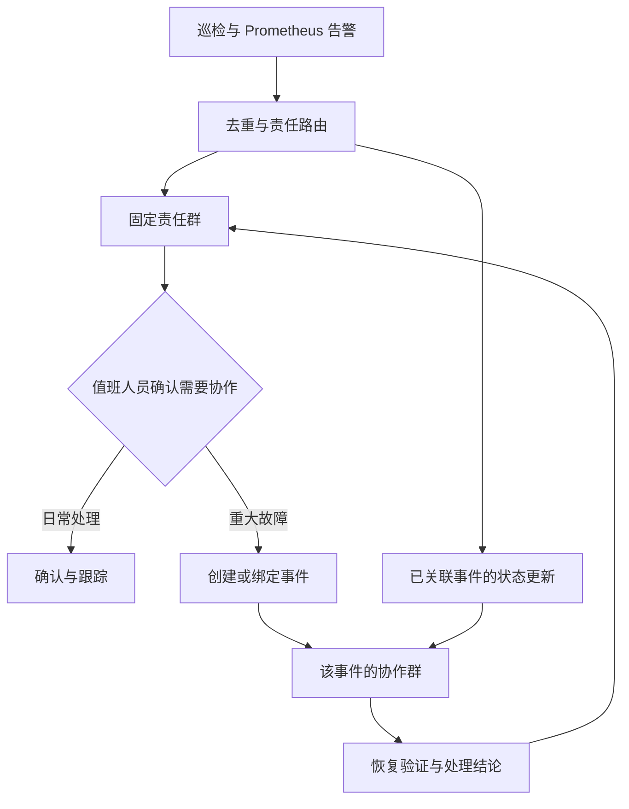

# 告警路由与建群策略调整

日期：2026-10-02。本文细化用户提出的“针对不同告警分别建群”问题，并补充到全项目整改路线图。以下是设计与实施建议，尚未修改业务代码、部署配置，也没有调用真实飞书接口。

**后续实施说明**：用户确认后，固定责任群通知、标签路由与交付基础校验已作为第一批落地，详见 [实施记录](C:/Users/23033/Desktop/Cluster-Stability-Inspector/审计/08-第一批整改实施记录-2026-10-02.md)。本文“当前方案”与源码行号保留整改前分析；人工事件升级、持久投递、自动关联等仍按后续阶段实施。

**推荐第一版：固定责任群承接日常告警；值班人员确认重大故障后，按一次故障事件建立协作群。默认关闭自动建群。** 后续在事件关联、持久状态和交付可靠性达标后，再开放少量明确规则的自动升级。

## 1. 当前方案的问题来自对象建模

现有链路是：Alertmanager 通知分组 → groupKey → 飞书群。告警通知的批次被当成了故障事件。

| 现状与源码 | 实际问题 | 调整方向 |
|---|---|---|
| [Alertmanager 配置](C:/Users/23033/Desktop/Cluster-Stability-Inspector/deploy/monitoring-alertmanager.yaml:10) 按 alertname、cluster、profile、check 分组 | 同一次故障会因告警规则名、巡检频率、检查组不同而拆成多个群 | 通知聚合与事件关联分别建模，profile 作为观测来源，不作为事件身份 |
| [Bridge](C:/Users/23033/Desktop/Cluster-Stability-Inspector/k8s_inspector/alertmanager_bridge.py:274) 用 groupKey 找群，找不到即 create_chat | 没有业务影响判断、人工升级条件和建群预算；日常异常也触发建群 | 固定群为默认目的地，建群由独立升级策略触发 |
| [告警规则](C:/Users/23033/Desktop/Cluster-Stability-Inspector/deploy/prometheus-alert-rules-k8s-inspector.yaml:27) 同时有 HasFail、CheckFail、PendingPVC | 同一 Pending PVC 可同时触发总览、检查组、专项三类告警；5m/hourly/daily 均可能观察到它 | 总览优先留在看板；可操作告警明确主要来源和覆盖范围，减少重复触达 |
| [群名](C:/Users/23033/Desktop/Cluster-Stability-Inspector/deploy/alertmanager-feishu-bridge.yaml:50) 只有 cluster、alertname | 不同 profile/check 的群可以同名；名字也无法区分两次独立故障 | 临时群包含事件编号、环境、对象和简短影响，例如 INC-20261002-0042 · prod · 存储写入故障 |
| [Bridge](C:/Users/23033/Desktop/Cluster-Stability-Inspector/k8s_inspector/alertmanager_bridge.py:295) 对同一 key 再次 firing 时重开旧群 | 下周相同告警可能混入上周的讨论，处理人员和结论难以追踪 | 事件有独立 episode；冷却窗口内复发可重开，窗口外视为新发生的一次事件 |
| [ChatRecord](C:/Users/23033/Desktop/Cluster-Stability-Inspector/k8s_inspector/state_store.py:21) 只有 chat_id、base_name、resolved | 无负责人、成员告警、确认状态、发送状态、事件起止；只能管理群名 | 改为事件、告警成员、投递任务三类状态 |
| [部署](C:/Users/23033/Desktop/Cluster-Stability-Inspector/deploy/alertmanager-feishu-bridge.yaml:72) 用 emptyDir 存群映射 | Pod 被替换后映射丢失，可能为旧问题重新建群 | 持久存储；存储异常禁止创建新群并降级到固定群，明确报告服务降级 |
| [状态存储](C:/Users/23033/Desktop/Cluster-Stability-Inspector/k8s_inspector/state_store.py:67) 读失败返回空字典，且创建与登记无并发约束 | 状态损坏被误当首次告警；同事件并发可能建多个群 | 区分未初始化与读取失败；唯一约束、事务、串行建群和外部操作核对 |

示例：一项持续 Pending PVC 在三个 profile 都被看到，并满足三类规则条件时，会形成九个不同通知分组，因此可能创建九个群。实际数量取决于各 profile 调度、规则持续时间与数据有效性；这不是每次必然出现的数量。即便只发生两三个群，也已经让同一故障的讨论分散。

反过来，同一检查组下两个互不相关的 PVC 故障，可能被聚合进同一个旧群。当前同时存在“一个故障拆成多个群”和“多个故障混在一个群”的问题。

Alertmanager 官方文档将 grouping 定义为把相似告警合并成一条通知；Webhook 的 groupKey 标识通知组，fingerprint 标识告警。业务事件与飞书群的关系需要本项目另行定义。[Alertmanager 概念](https://prometheus.io/docs/alerting/latest/alertmanager/)、[Webhook 字段](https://prometheus.io/docs/alerting/latest/configuration/#webhook_config)。

## 2. 推荐的通知与协作策略

固定群按责任归属设置，而非按检查项设置。小规模环境可先用一个 SRE 值班群；组织有明确职责时，增加平台/存储/业务团队群。群数量由实际团队决定，不必为每个集群、namespace、rule 自动建一个。

| 情况 | 首次通知与后续动作 | 是否建事件群 |
|---|---|---|
| 常规 WARN、容量风险、短时异常 | 发固定责任群；持续异常按去重与提醒策略汇总，日报记录趋势 | 否 |
| 明确故障，但一个值班人员可以处理 | 发固定责任群，带对象、影响、操作建议和负责人；按升级时限提醒 | 默认否 |
| 生产业务明显受损，需多人或跨团队协作 | 先发固定责任群；值班人员确认事件、指定负责人，再创建或绑定协作群 | 是，由人工升级 |
| 同一事件的重复通知、关联症状、部分恢复 | 更新对应事件的摘要和时间线；固定群保留状态变化与协作入口 | 复用该事件群 |
| 巡检失明、指标失效、Bridge 交付失败 | 发平台值班群，并明确状态未知；不要宣称业务故障已经恢复 | 默认否；重大影响时人工升级 |

`severity=critical` 单独不足以触发建群。目前 PendingPVC、CheckFail、HasFail 等规则广泛使用 critical，它不是已经评估过的重大事故等级。自动升级应结合明确业务影响、持续时间和协作需要，而不能简单地把所有 critical 自动建群。

第一版人工升级可以先做受控命令或内部接口，由值班人员填入事件标题、责任人和关联告警。若之后接飞书卡片按钮，需要另外实现回调鉴权、操作者授权、幂等与审计，不能只画一个按钮就视为能力已经完成。

## 3. 事件身份与关联规则

需要明确四个对象，避免继续用一个 key 兼任所有身份。

| 对象 | 身份及用途 |
|---|---|
| 告警实例 | source_id + fingerprint；startsAt 等信息区分同标签告警的不同发生周期，并处理重试/乱序 |
| 通知批次 | source_id + receiver + groupKey；用于理解 Alertmanager 的聚合与交付来源 |
| 故障事件 | 独立 incident_id；关联范围 correlation_key、发生周期 episode、成员告警、责任人与状态 |
| 通知目的地 | 固定群 chat_id，或该事件绑定的协作群 chat_id；两者都不能由 groupKey 自动推导 |

source_id 用于区分来源系统；HA 实例的来源标识需按部署方式规范化，不能给每个副本随意生成一个新值导致重复事件。fingerprint 随标签变化而变化，也不能直接代替事件编号。

事件关联首先依赖责任归属和对象证据：cluster、namespace、稳定资源 UID、工作负载 owner、故障类别。profile、severity、告警名称用于描述发现来源和状态变化，不直接决定同一次事件。

可从明确的关联规则开始：某节点持续 NotReady，且一批异常 Pod 确实分布在该节点，可由值班人员将它们关联到同一事件；某个 PVC 无法供应，使用它的 Pod 出现挂载失败，可作为一个存储事件的相关症状。关联表示共同处理范围，不自动证明根因。

不能仅因“同一集群 + 相近时间”合并所有告警。不同 namespace、不同 owner 的两个 CrashLoop 可能完全独立；多个节点同时异常也需要进一步证据，不能自动断言一个根因。

当前 Prometheus 指标主要是 cluster/profile/check 聚合，缺少这些资源级关系。需要先让结构化 Finding/报告提供资源 UID、owner 与对象关系，再设计自动关联。不要为了关联而无约束地把每个资源字段都做成长期 Prometheus 标签；详细身份可保存在报告或事件存储，指标保持受控基数。第一版使用人工关联更适合当前数据质量。

## 4. 群和消息的生命周期

建议事件状态采用 OPEN → ACKNOWLEDGED → INVESTIGATING → RESOLVED → CLOSED，另有 REOPENED 转移；具体命名可以简化，但必须区分“有人接手”“已验证恢复”“已完成结案”。状态未知应独立记录，不强塞成 resolved。

- 建群时记录事件编号、影响范围、负责人、成员告警、首次发生时间、报告链接和创建操作状态。固定责任群收到协作入口，方便后来值班人员追踪。
- 按所属团队、当前值班人员、事件负责人确定参与人，按需增补其他团队。不要把配置中的全部用户拉进每个群；人员路由缺失时退回平台值班群并记录原因。
- 重复 Webhook 不反复发同一张卡片。重要状态变化立即通知，持续异常按提醒间隔发送聚合摘要。当前 SDK 可以向指定 chat_id 发卡片；卡片原地编辑能力应在具体 API/权限核实并实现后再启用，第一版用状态变化卡片即可。
- 部分子告警 resolved，只更新该成员；事件仍有活动成员或关键状态未知时，保留事件处理中/待验证状态。
- Webhook 没出现某条告警，不代表它已恢复。截断、silence、inhibition、路由变更、数据失效都可能影响通知；要识别 truncatedAlerts，并对事件成员做状态核对或用新鲜有效巡检结果验证。
- 所有应纳入的成员已恢复、关键采集有效且观察窗口通过后，发送恢复结论；负责人补充处置结果后结案。恢复消息未成功投递时保持待发送任务，不能因为改过群名就跳过重试。
- 冷却窗口内同对象复发，可重开原事件；结案后超过窗口的新故障生成新 episode。窗口是业务配置，不能直接由告警 repeat_interval 代替。
- 结案群保留讨论与事件记录，按组织规则人工处理归档；不在第一版自动解散、删除或大批量清理旧群。

并发与存储要一起修复。单实例第一版可使用本地持久卷上的 SQLite、事件唯一约束及投递队列。不要用共享 NFS 上的 SQLite 充当多副本数据库。创建群是外部副作用：创建成功但本地登记失败时，数据库锁也无法保证端到端恰好一次；应把该操作标记待核对，避免盲目重建。外部接口若提供可用的幂等机制，再按已核实的接口接入。

建群能力应有独立开关、每时段创建预算、活跃事件群上限与失败熔断。触顶或创建失败时仍向固定群投递并说明降级。预算保护建群接口，不能把告警本身静默丢弃；具体数值按真实值班容量制定。

## 5. 对现有代码的调整边界

发送方式和建群策略需要解耦：

| 维度 | 推荐设计 |
|---|---|
| delivery_mode | webhook 或 app，决定发送接口；app 也可以只向已有群发卡片 |
| default_destination | 预先配置的固定群/固定 webhook，按责任归属路由 |
| incident_creation | disabled、manual、受控 auto，决定是否允许创建事件协作群 |
| escalation_policy | 谁可以升级、影响条件、值班参与人、限额、失败降级 |

以上是拟新增概念，当前 CLI/配置尚不支持这些字段。不能把它们直接写进现有 YAML 并期待生效。

| 文件 | 建议改动 |
|---|---|
| [alertmanager_bridge.py](C:/Users/23033/Desktop/Cluster-Stability-Inspector/k8s_inspector/alertmanager_bridge.py:262) | 拆开 Webhook 标准化、告警成员更新、责任路由、事件升级、消息投递；去除“无 groupKey 记录就建群”的默认行为；完整处理所有 alerts，而不是用第一条的 profile/check 描述全组 |
| [state_store.py](C:/Users/23033/Desktop/Cluster-Stability-Inspector/k8s_inspector/state_store.py:21) | 从 groupKey→ChatRecord 改为事件/成员/投递状态；区分数据损坏与空存储，支持唯一约束、事务和核对 |
| [feishu_app.py](C:/Users/23033/Desktop/Cluster-Stability-Inspector/k8s_inspector/feishu_app.py:41) | 保留 create_chat/send_card_message 等适配接口；支持发送到预配置 chat_id；扩展超时、错误分类和已核实的幂等机制，事件策略不塞进 SDK 客户端 |
| [两份 Alertmanager 配置](C:/Users/23033/Desktop/Cluster-Stability-Inspector/deploy/monitoring-alertmanager.yaml:10) | 同步维护主配置与 snippet；过渡版可按 cluster 聚合发平台固定群，有规范 owner_team 后按 cluster+owner_team 路由聚合；必要时保留故障类别维度 |
| [Prometheus 规则](C:/Users/23033/Desktop/Cluster-Stability-Inspector/deploy/prometheus-alert-rules-k8s-inspector.yaml:27)及嵌入配置 | 避免总览/检查组/专项重复通知，明确每类检查的主要告警来源；覆盖不完整前不直接删掉总览告警，其他独立故障不能被过宽抑制 |
| [Bridge Deployment](C:/Users/23033/Desktop/Cluster-Stability-Inspector/deploy/alertmanager-feishu-bridge.yaml:53) | 状态持久化、单实例部署约束与更新策略、固定目的地配置、运行健康与投递失败监控 |

**仅修改 group_by 无法完成整改。** 它可以减少通知批次，却不会建立事件编号、责任人、子告警集合和交付状态；直接按 cluster 建群还会把整个集群的独立事故混在一起。调整聚合时，Bridge 也必须能处理混合 profile/check，不能继续取第一条告警再给全组配一份报告。

若临时需要立刻减少新群，现有 webhook 模式可以向固定群发文本，是现成过渡路径；需要卡片则实现 app 向已有 chat_id 发送。前者不会同时自动修复重复规则、消息噪声和恢复判断。

## 6. 实施顺序与验收

1. **先控制建群**：增加固定目的地与独立建群开关，默认关闭创建；配置平台兜底路由。梳理已有活跃群，不让配置变更自动批量建新群或修改历史群。
2. **降低日常噪声**：理清总览/检查组/专项告警的覆盖，指定主要检查来源；按责任团队聚合通知，保留 profile 来源信息。消息显示完整对象范围，修复仅取首条标签的行为。
3. **修复状态与交付**：持久状态、并发约束、投递任务、失败重试、乱序检查与外部创建结果核对。旧 groupKey→chat_id 作为旧群登记信息保存，不默认导入为新的业务事件。
4. **上线人工事件升级**：受控入口、事件编号、责任人、子告警关联、创建/绑定现有群、固定群入口、恢复核验与结案。用户可处理日常告警而不创建协作群。
5. **观察后再考虑自动升级**：先以 dry-run 记录“本来会建哪些群”，评估错误关联与群数量，再只启用明确、低误判的规则；常规 WARN 与单项 critical 不自动升级。

关键验收场景：

| 场景 | 必须达到的行为 |
|---|---|
| 同一 PVC 被多个 profile 和多条规则发现 | 默认不建群；关联到事件时不因 profile 增加群数量，通知中保留来源 |
| 同类告警涉及两个独立 workload/owner | 可以独立跟踪，不因同 cluster 或 alertname 合并为一个事故 |
| 同一升级请求重试或并发到达 | 只产生一个逻辑事件和一个已登记协作群；外部结果不明进入核对，而非盲目重建 |
| Bridge Pod 被替换 | 已有事件/chat_id/待投递任务可恢复 |
| 状态文件损坏或数据库不可用 | 显式降级、禁止新群、尝试固定群投递并暴露失败 |
| 一个成员恢复但其他成员仍故障 | 不结案，不把群改成已解决 |
| 指标过期、通知缺项或发生截断 | 保留未知/待验证状态，不能假恢复 |
| 恢复卡片发送失败 | 可以重试；事件恢复状态与消息投递状态分别记录 |
| 同对象结案后再次故障 | 按冷却窗口决定复开或新 episode，不能无限复用历史讨论 |
| 大规模告警同时到达 | 建群预算有效，固定通知通道可用，失败与积压有指标 |

本文应与 [全项目整改路线图](C:/Users/23033/Desktop/Cluster-Stability-Inspector/审计/05-整改路线图-2026-10-02.md) 的 S1/S3 合并实施。第一批以“固定群、减少噪声、可靠投递”为验收目标；事件自动关联与自动建群不作为首个可靠巡检版本的前提。
